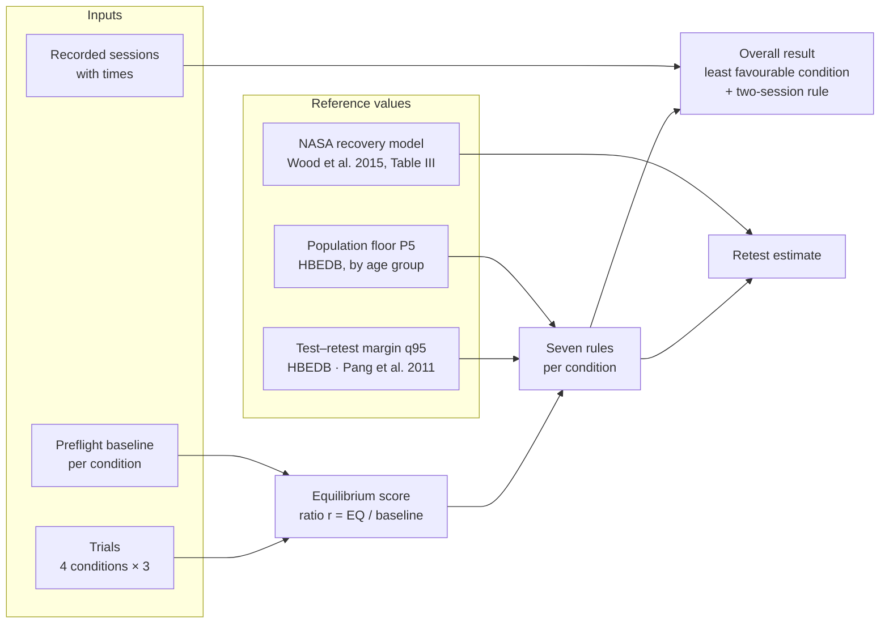

# Technical documentation

This section describes how a balance recording becomes a decision and a retest estimate. Each page states the
method, the source of every value and the assumption it rests on.

| Page | Content |
|---|---|
| [Measurement and score](measurement.md) | Test protocol, centre-of-mass estimation and the equilibrium score |
| [Decision rules](decision.md) | The seven rules, the GO threshold and the two-session requirement |
| [Retest estimate](forecast.md) | The NASA crew recovery model applied to an individual measurement |
| [Pharmacological scenario](medicine.md) | Promethazine concentration and its effect on the retest estimate |
| [Validation](validation.md) | Calibration against NASA crew data, healthy retest and automated tests |
| [Assumptions and limitations](limitations.md) | What the model assumes and what it does not establish |

## Design principles

1. **Status comes only from a measured test.** The recovery forecast estimates when to retest and never yields GO.
2. **Each person is compared with their own baseline.** Scores are expressed as a ratio to the crew member's
   preflight score in the same condition, never across conditions.
3. **Rules are explicit and ordered.** Every result names the rule that produced it.
4. **Uncertainty favours a retest.** Test–retest variability is allowed for before GO is returned, and an overall GO
   requires two sessions.
5. **Nothing is trained.** No public dataset labels individuals as fit or unfit to leave a vehicle, so every
   threshold is derived from published values or from healthy reference data.

## Architecture

Swipe sideways to see the whole diagram.

The application is written in Python. The decision engine (`readiness/decision.py`), the forecast
(`readiness/forecast.py`), the signal processing (`readiness/signals.py`) and the pharmacological model
(`readiness/medicine.py`) are separate modules, and the interface (`app.py`, Streamlit) only displays their output.
