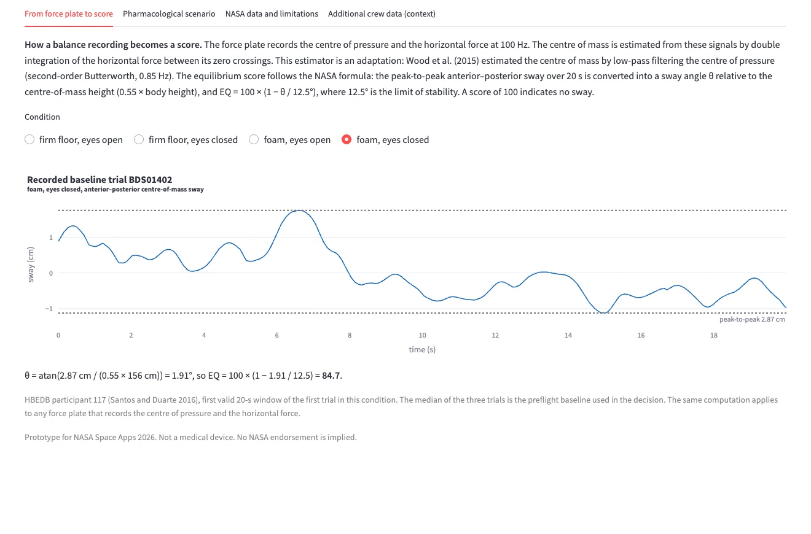

# Measurement and score

## Test protocol

The crew member stands still on a force plate for three 20-s trials in each of four sensory conditions.

| Condition | Sensory information available | NASA analogue |
|---|---|---|
| Firm floor, eyes open | Vision, vestibular, somatosensory | Sensory Organization Test condition 1 |
| Firm floor, eyes closed | Vestibular, somatosensory | Condition 2 |
| Foam, eyes open | Vision, vestibular, reduced somatosensory | Condition 4 (approximation) |
| Foam, eyes closed | Vestibular, reduced somatosensory | Condition 5 (approximation) |

Condition 5, with eyes closed on a sway-referenced support, is the condition most affected after spaceflight because
the crew member must rely on the vestibular system. NASA uses a sway-referenced platform. This prototype uses foam,
which Jain et al. (2010) proposed as a simpler substitute while noting that the two are not strictly equivalent.
They also report that foam testing was tried with one Shuttle crew on landing day and abandoned after the crew
reported concern that it disrupted their postflight recovery. Tolerability of the test on landing day is therefore
unresolved.

The test challenges balance in crew members who may fall. It is administered with a spotter or a safety harness,
and a fall is recorded as a trial outcome.

## From force plate to centre of mass

The force plate records the centre of pressure and the horizontal ground-reaction force at 100 Hz. The centre of
mass is estimated by zero-point-to-zero-point double integration (Zatsiorsky and King 1998). When the horizontal
force is zero, the centre of mass lies directly above the centre of pressure. Between consecutive zero crossings, the
horizontal acceleration \(a = -F_x / m\) is integrated twice, with the initial velocity chosen so that the centre
of mass coincides with the centre of pressure at both crossings.

This estimator is an adaptation. Wood et al. (2015) estimated the centre of mass by low-pass filtering the centre of
pressure (second-order Butterworth, 0.85 Hz). The equilibrium-score formula is the same, but the complete NASA
measurement pipeline is not reproduced.

The first complete 20-s window of each trial is used. A window is accepted only if at least 99% of its samples are
valid and the sway exceeds the instrument noise floor.

## Equilibrium score

The equilibrium score converts the peak-to-peak anterior–posterior sway of the centre of mass over 20 s into a sway
angle relative to the height of the centre of mass, taken as 0.55 of body height \(H\):

\[
\theta = \arctan\!\left(\frac{x_{\max} - x_{\min}}{0.55\,H}\right), \qquad
\mathrm{EQ} = 100\left(1 - \frac{\theta}{12.5^\circ}\right)
\]

where 12.5° is the limit of stability. A score of 100 indicates no sway. The score is multiplied by the fraction of
the trial completed and is not allowed to fall below 0. A fall yields NO-GO whatever the score (rule 2).

**Worked example.** For the first baseline trial of participant A on foam with eyes closed (HBEDB trial BDS01402),
the peak-to-peak sway is 2.87 cm and the body height 156 cm:

\[
\theta = \arctan\!\left(\frac{2.87}{0.55 \times 156}\right) = 1.91^\circ, \qquad
\mathrm{EQ} = 100\left(1 - \frac{1.91}{12.5}\right) = 84.7
\]

The application reproduces this computation in the tab *From force plate to score*.

<figure class="shot" markdown>

<figcaption>A recorded baseline trial, its peak-to-peak sway and the resulting equilibrium score.</figcaption>
</figure>

## Score relative to baseline

For each condition \(c\), the session score is the median of the three trial scores, and the decision uses its ratio
to the crew member's preflight baseline in the same condition:

\[
r_c = \frac{\operatorname{median}(\mathrm{EQ}_{c,1}, \mathrm{EQ}_{c,2}, \mathrm{EQ}_{c,3})}{b_c}
\]

The baseline \(b_c\) is the median of the three preflight trials. A score is never compared with a baseline from a
different condition.

Balance scores improve with repeated testing. Jain et al. (2010) excluded the first two preflight sessions for this
reason, and Wood et al. (2015) used the last of two preflight sessions. A baseline taken without familiarisation
underestimates true performance and inflates later ratios. The familiarisation protocol is not specified in this
prototype, and the single-session HBEDB recordings used as preflight proxies cannot establish it.
