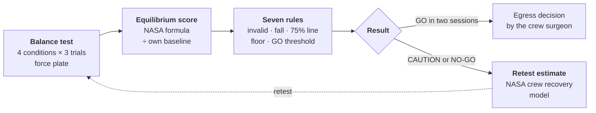

## Overview

After International Space Station (ISS) missions, crew balance with eyes closed on a sway-referenced support had a
mean equilibrium score of 74.9 before flight, and the NASA recovery model estimates 13.2 at landing (n = 37,
Wood et al. 2015). In a separate NASA study of 11 first-time astronauts tested 2–5 h after Space Shuttle landing,
20 of 22 eyes-closed trials with prescribed head movements ended in a fall (Jain et al. 2010). NASA lists the
*Risk of Altered Sensorimotor/Vestibular Function Impacting Critical Mission Tasks* among the risks of human
spaceflight.

The Gravity-Transition Readiness Model addresses the first task after landing: leaving the vehicle. It converts a
standing-balance test into one of four results, **GO**, **CAUTION**, **NO-GO** or **CANNOT ASSESS**, names the rule
that produced it and states the next action. When the result is not GO, it estimates the retest time from the
published NASA crew recovery model.

The model is deterministic. The thresholds combine published values, reference data from healthy adults and stated
design choices, each documented with its source, and every result can be traced to a numbered rule. No model is
trained, because no public dataset known to us labels individuals as fit or unfit to leave a vehicle.

## The decision in one picture

Swipe sideways to see the whole diagram.

## What the application provides

- **An interactive model.** The user sets the inputs of a balance test, and the result, the rule applied and the
  recommended action update immediately.
- **Explicit safety rules.** Seven numbered rules, applied in a fixed order. A fall always yields NO-GO, an invalid
  recording yields CANNOT ASSESS, and overall GO requires two GO sessions at least 2 h apart.
- **A retest estimate.** The time at which typical NASA crew recovery brings every condition to its GO threshold,
  with a range from the published confidence limits.
- **A comparison with typical NASA crew.** Each recorded session is placed on the NASA recovery curve of each
  condition.
- **Traceable data.** Every cited value is listed with its source and page, and every simulated result is labelled
  as simulated.

The output supports the crew surgeon and does not constitute clearance.
