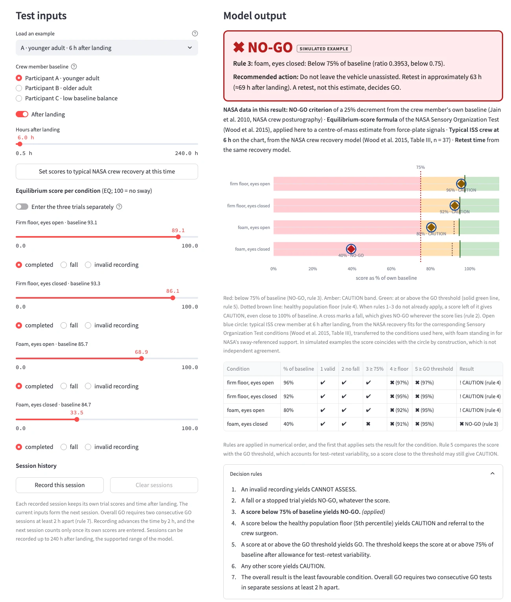

# How to use the app

**[Open the app](https://vishram0905.github.io/gravity-readiness-app/){ target="_blank" }** in any modern browser. No installation or sign-in is needed. The
model runs entirely in the browser, so the first visit takes about 20–40 s to load and later visits are faster.

The application is an interactive model. The inputs of a balance test are set on the left of the page, and the
model output on the right updates immediately. No button needs to be pressed to obtain a result.

## Running it locally

The application can also be run on a local machine with Python 3.11 or later.

```bash
git clone https://github.com/vishram0905/gravity-readiness.git
cd gravity-readiness
python3 -m venv .venv
.venv/bin/pip install -r requirements.txt
.venv/bin/streamlit run app.py
```

The application opens in the browser at `http://localhost:8501`. The demonstration data of three participants are
included in the repository, so no download is needed.

## Page layout

<figure class="shot" markdown>

<figcaption>The page six hours after a simulated landing. Left: test inputs. Right: the result card, the chart of
each sensory condition against its thresholds, the rule-by-rule table and the numbered decision rules.</figcaption>
</figure>

From top to bottom, the page contains:

| Section | Content |
|---|---|
| Header | The question addressed, the measurement and the decision, in three short paragraphs |
| Test inputs (left) | Example list, crew member baseline, time after landing, equilibrium score and trial outcome for each condition, session history |
| Model output (right) | Result card with the rule applied and the recommended action, the NASA data used, the condition chart, the rule table and the decision rules |
| Estimated retest time | Shown after a landing when the result is CAUTION or NO-GO |
| Recovery compared with typical NASA crew | Shown after a landing. Each session placed on the NASA recovery curve of each condition |
| Tabs | From force plate to score · Pharmacological scenario · NASA data and limitations · Additional crew data |

## Quick start

1. Open **Load an example** and select *A · younger adult · 6 h after landing*. The result is
   <span class="status nogo">NO-GO</span>, because the score on foam with eyes closed is below 75% of baseline.
   The card recommends a retest in approximately 63 h.
2. Drag the slider for **Foam, eyes closed** to the right. The marker on the chart moves, and when the score passes
   the 75% line the result changes to <span class="status caution">CAUTION</span>. The other three conditions are
   still below their GO thresholds at 6 h, so the rule table shows which condition now determines the result.
3. Set any trial outcome to **fall**. The result is <span class="status nogo">NO-GO</span> under rule 2, whatever
   the score.
4. Select *A · younger adult · 71 h after landing, confirmatory session*. Two recorded GO sessions give
   <span class="status go">GO</span>, and the egress decision rests with the crew surgeon.

[A worked session](walkthrough.md) follows one crew member from landing to GO. [Inputs and outputs](reference.md)
describes every control and every element of the output.

!!! note "Simulated post-landing sessions"
    The participants are healthy adults from the Human Balance Evaluation Database, not astronauts. Post-landing
    sessions are simulated by scaling each participant's own recorded trials onto the typical NASA crew recovery
    curve, and the result card labels them **SIMULATED EXAMPLE**.
