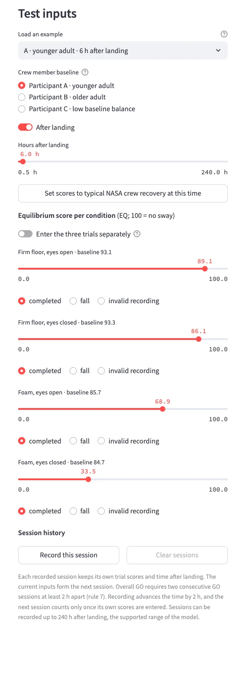

# Inputs and outputs

## Inputs

<figure class="shot" markdown style="max-width:420px">

<figcaption>The input column.</figcaption>
</figure>

| Control | Description |
|---|---|
| **Load an example** | Fills every control with a recorded or simulated test and resets the pharmacological scenario to no dose. The examples are listed below. |
| **Reset to this example's values** | Restores the crew member, the time, every score and trial outcome, the session history and the pharmacological scenario to the values of the selected example. The input mode and the condition shown in the *From force plate to score* tab are kept. |
| **Crew member baseline** | Three option buttons. Preflight baseline and age group. The reference scores of three HBEDB participants serve as preflight proxies. Changing the crew member clears the session history. |
| **After landing** | Off for a baseline-day test. On for a test after landing, which enables the time control, the retest estimate and the comparison with NASA crew. |
| **Hours after landing** | 0.5–240 h in steps of 0.5 h. |
| **Set scores to typical NASA crew recovery at this time** | Replaces the scores with the participant's own trial spread placed on the typical NASA recovery curve at the chosen time. Falls and invalid recordings are kept. |
| **Equilibrium score per condition** | One slider per sensory condition (0–100, step 0.1). The label gives the participant's baseline. |
| **Enter the three trials separately** | Replaces each slider with three trial scores. The decision uses their median. |
| **Trial outcome** | *completed*, *fall* or *invalid recording*, for each condition. |
| **Record this session** | Stores the current session with its trial scores, outcomes, time and source, and advances the time by 2 h. Available after a landing, up to 240 h. |
| **Clear sessions** | Removes every recorded session. |

Further controls below the results:

| Control | Description |
|---|---|
| **Planned dose (mg)** | Pharmacological scenario panel, directly below the retest chart: 0, 12.5, 25 or 50 mg of promethazine. 0 switches the scenario off. Available only after a landing, when every condition has a valid recording and no fall has occurred. |
| **Route** | Oral or intramuscular. |
| **Dose time** | 0–48 h after the current session, in steps of 0.5 h. |
| **Condition** | From force plate to score tab: the sensory condition whose recorded baseline trial is shown. |
| **Analyte** | Additional crew data tab: one of seven blood analytes. |

## Outputs

### Result card

The card gives the status, the rule applied and the recommended action.

| Status | Meaning |
|---|---|
| GO | Two consecutive GO sessions at least 2 h apart. The egress decision rests with the crew surgeon. |
| CAUTION | A single GO session awaiting confirmation, a score between the 75% line and the GO threshold, or a score below the healthy population floor. |
| NO-GO | A fall, or a score below 75% of baseline. Do not leave the vehicle unassisted. |
| CANNOT ASSESS | An invalid recording, or session times that are missing or out of order. |

Each status is shown by word and symbol as well as colour. A tag gives the source of the values:
**HBEDB RECORDING**, **SIMULATED EXAMPLE**, **SIMULATED: TYPICAL NASA RECOVERY** or **USER-ENTERED VALUES**.

### NASA data in this result

A line under the card lists the NASA data that entered the result: the 25% NO-GO criterion (Jain et al. 2010), the
equilibrium-score formula of the NASA Sensory Organization Test, the typical ISS crew member at the same time after
landing and, where shown, the retest time (Wood et al. 2015).

### Condition chart

| Element | Meaning |
|---|---|
| Red band | Below 75% of baseline (NO-GO, rule 3) |
| Amber band | CAUTION band |
| Green band and solid green line | At or above the GO threshold (rule 5) |
| Dotted brown line | Healthy population floor (rule 4) |
| Diamond / cross | Participant's score / a fall |
| Open blue circle | Typical ISS crew member at the same time after landing |

### Rule table

For each condition, the table shows the score as a percentage of baseline, whether each of rules 1–5 is met, and
the resulting status with the rule that produced it. Rules are applied in numerical order, and the first that
applies sets the result. The numbered rules are listed under the table, with the applied rule marked.

### Estimated retest time

Shown after a landing when every condition has a valid recording, no fall has occurred and the session is not GO.
It is also shown for a GO session when a planned dose is predicted to lower a score below its GO threshold. It is not
shown for a GO session awaiting confirmation without a dose, after a fall, or when the result is CANNOT ASSESS,
including session times out of order. The chart shows the recovery curve of the condition that
reaches its GO threshold last, the estimated retest time and its range. Conditions already at or above their GO threshold need no recovery. When the GO threshold of a
condition still below it cannot be reached, no time is shown and the card refers the crew member to the crew
surgeon. A retest time later than 240 h after landing is labelled as an extrapolation.

### Recovery compared with typical NASA crew

Shown after a landing. Four panels, one per condition, place the recorded sessions (filled points) and the current
session (open point) on the NASA recovery curve. Invalid recordings and a session timed before the last recorded
session are not plotted.

### Tabs

| Tab | Content |
|---|---|
| From force plate to score | A recorded baseline trial of the participant and the step-by-step computation of its equilibrium score |
| Pharmacological scenario | A planned promethazine dose and its effect on the retest estimate, with warnings |
| NASA data and limitations | Sources, protocol and transfer assumptions, validation and safeguards |
| Additional crew data (context) | NASA OSDR Inspiration4 crew blood panels relative to each crew member's preflight mean. Context only |

## Examples

| Example | Result | Rule |
|---|---|---|
| A · younger adult · 6 h after landing | NO-GO, retest in approximately 63 h | 3 |
| A · younger adult · 69 h after landing, first GO | CAUTION, confirmatory session required | 7 |
| A · younger adult · 71 h after landing, confirmatory session | GO | 7 |
| A · younger adult · baseline day, simulated fall | NO-GO | 2 |
| A · younger adult · baseline day, no landing | CAUTION, confirmatory session required | 7 |
| B · older adult · 6 h after landing | NO-GO, no retest estimate | 3 |
| B · older adult · 240 h after landing, GO not reached | CAUTION | 6 |
| B · older adult · baseline day, simulated fall | NO-GO | 2 |
| B · older adult · baseline day, no landing | CAUTION | 6 |
| C · low baseline balance · 6 h after landing | NO-GO, no retest estimate | 3 |
| C · low baseline balance · 240 h after landing, GO not reached | CAUTION | 4 |
| C · low baseline balance · baseline day, simulated fall | NO-GO | 2 |
| C · low baseline balance · baseline day, no landing | CAUTION | 4 |

For participant B, test–retest variability on foam is large in older adults, so the GO thresholds on both foam
conditions lie above baseline and GO is not reached. This is a deliberate safety trade-off: the rules prefer a retest to
a false clearance.
