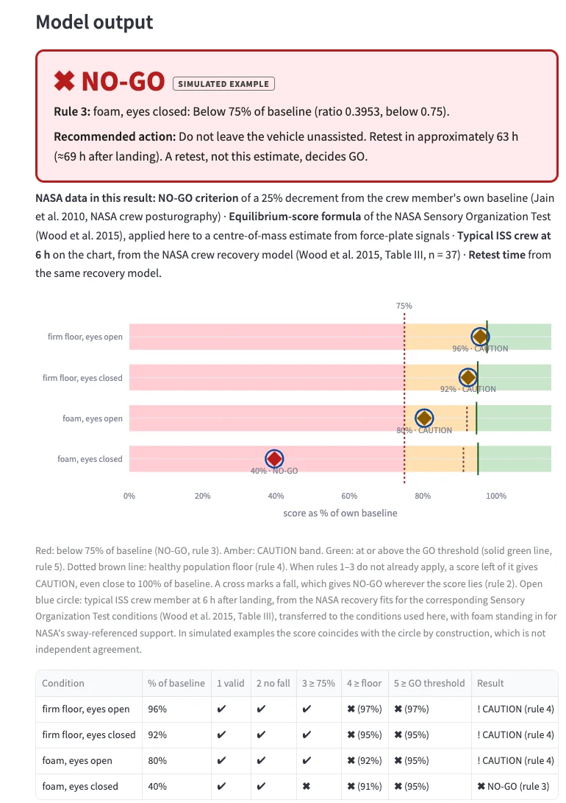
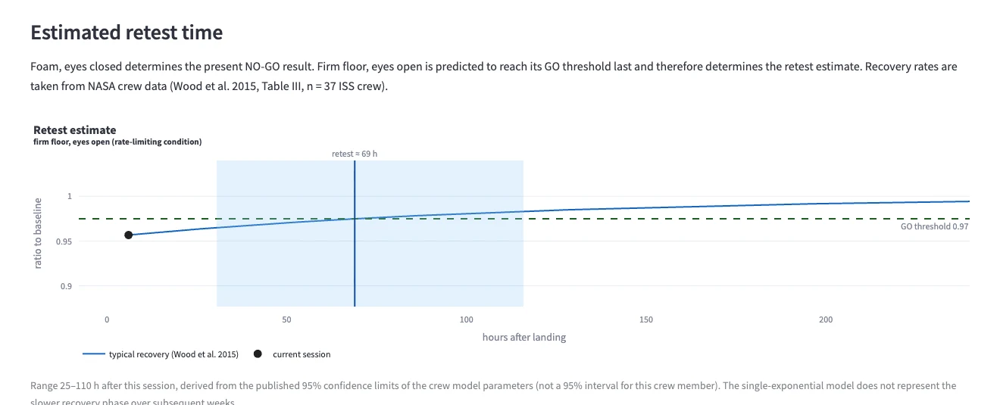
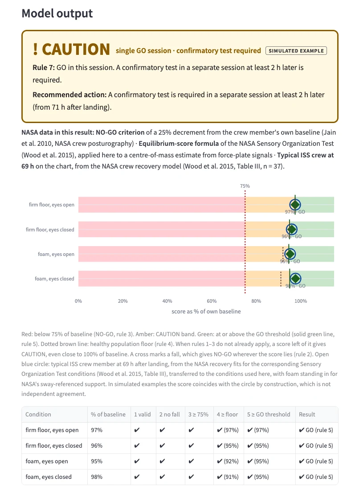
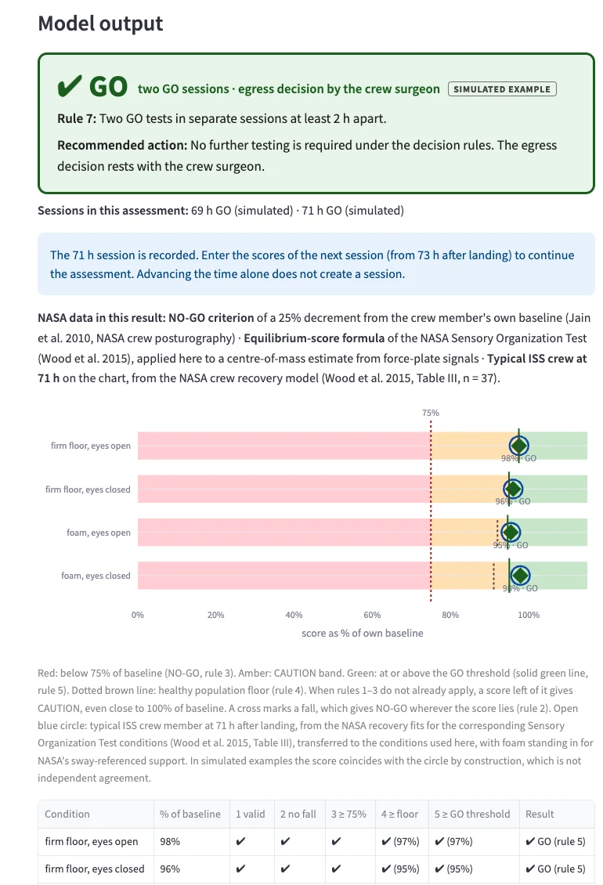
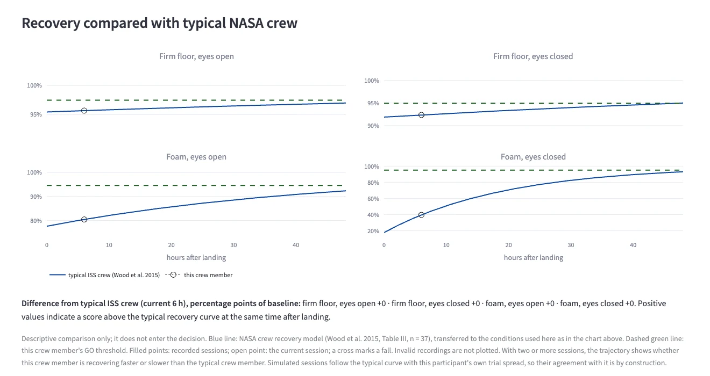
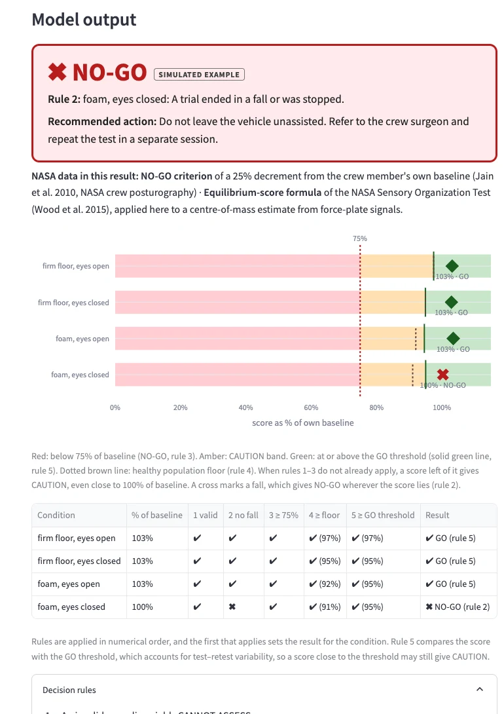
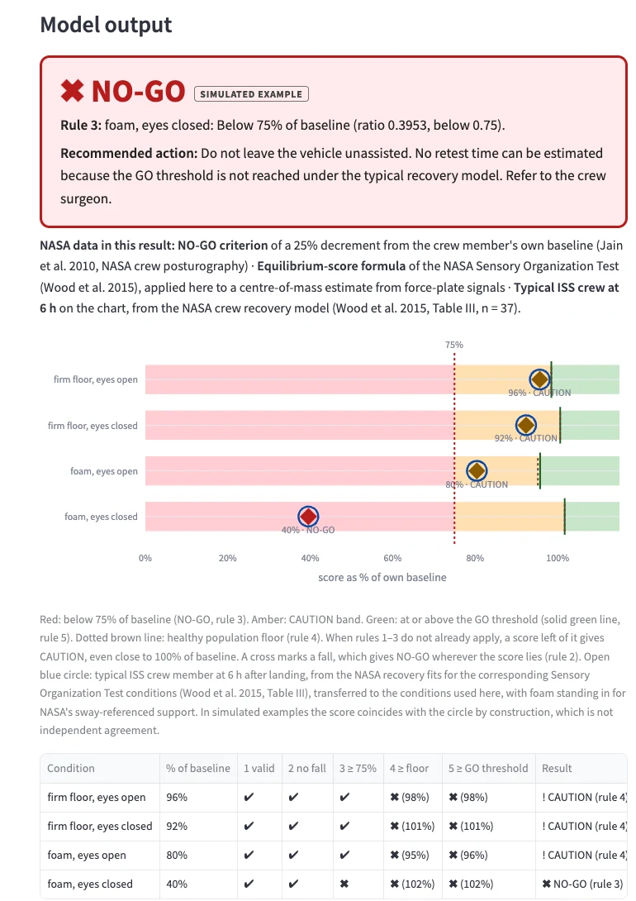

# A worked session

This page follows participant A, a younger adult, from a simulated landing to an overall GO. Every value below is
the output of the application for the corresponding example.

## 1 · Six hours after landing

Select *A · younger adult · 6 h after landing*.

<figure class="shot" markdown>

<figcaption>Result six hours after a simulated landing.</figcaption>
</figure>

The result is NO-GO under **rule 3**: on foam with eyes closed, the score is
40% of the participant's own baseline, below the 75% line. The other three conditions are at 80–96% of baseline but
below the healthy population floor, which limits each of them to CAUTION under rule 4. The least favourable
condition sets the overall result.

The recommended action reads: *Do not leave the vehicle unassisted. Retest in approximately 63 h (≈69 h after
landing). A retest, not this estimate, decides GO.*

On the chart, each diamond is the participant's score, the solid green line is the GO threshold of that condition,
the dotted brown line is the healthy population floor, and the open blue circle is the typical ISS crew member at
the same time after landing (Wood et al. 2015, Table III).

## 2 · When to retest

<figure class="shot" markdown>

<figcaption>Estimated retest time. The blue curve is the typical recovery rate applied to the measured deficit, the
dashed line is the GO threshold and the shaded band is the range.</figcaption>
</figure>

Foam with eyes closed determines the present NO-GO, but it recovers fastest (time constant 19.4 h). Firm floor with
eyes open has a small deficit and a long time constant (116.1 h), and its GO threshold lies close to baseline, so
it reaches its threshold last and sets the estimate: approximately 63 h after this session, with a range of 25–110 h
derived from the published 95% confidence limits of the recovery time constant. The method is described in
[Retest estimate](../documentation/forecast.md).

## 3 · First GO session, 69 h after landing

Select *A · younger adult · 69 h after landing, first GO*.

<figure class="shot" markdown>

<figcaption>Every condition is GO, and the overall result remains CAUTION until a confirmatory session.</figcaption>
</figure>

Every condition now reaches its GO threshold, so the session is GO. The overall result is
CAUTION under **rule 7**, which requires two consecutive GO sessions at least
2 h apart. The card states: *A confirmatory test is required in a separate session at least 2 h later (from 71 h
after landing).*

To continue in the application, press **Record this session**. The time advances to 71 h, and the next session
counts only once its own scores have been entered.

## 4 · Confirmatory session, 71 h after landing

Select *A · younger adult · 71 h after landing, confirmatory session*, which contains both recorded sessions.

<figure class="shot" markdown>

<figcaption>Two recorded GO sessions, 69 h and 71 h after landing.</figcaption>
</figure>

The result is GO: *No further testing is required under the decision rules. The
egress decision rests with the crew surgeon.* The session list shows both sessions and their source.

## 5 · Comparison with typical NASA crew

<figure class="shot" markdown>

<figcaption>Each panel shows the NASA recovery curve of one condition, the participant's sessions and the GO
threshold. The line below gives the difference from the typical crew member at the latest session.</figcaption>
</figure>

With several recorded sessions, the points show whether the crew member is recovering faster or slower than the
typical ISS crew member. Simulated sessions follow the typical curve by construction. The comparison is descriptive
and does not enter the decision.

## Two further cases

**A fall.** In *A · younger adult · baseline day, simulated fall*, one trial on foam with eyes closed ends in a fall.
The result is NO-GO under rule 2, whatever the score, and the card recommends
referral to the crew surgeon and a repeat test in a separate session.

<figure class="shot" markdown>

<figcaption>A fall gives NO-GO. The cross on the chart marks the condition in which it occurred.</figcaption>
</figure>

**No retest estimate.** For participant C, whose baselines on the firm floor with eyes closed and on foam with eyes
closed lie below the healthy population floor, the GO threshold cannot be reached under the recovery model. The card states that no retest time can be estimated
and refers the crew member to the crew surgeon. The application does not extrapolate a time it cannot support.

<figure class="shot" markdown>

<figcaption>Participant C six hours after a simulated landing.</figcaption>
</figure>
